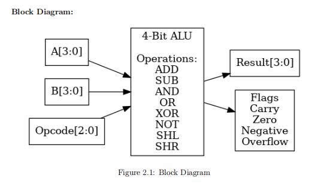
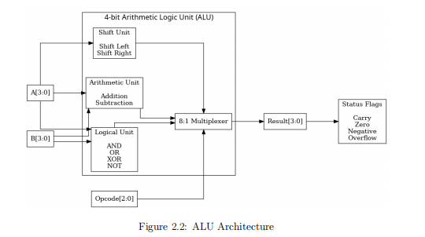
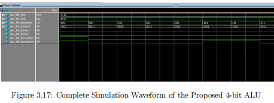

# RTL Design and Functional Verification of a 4-bit ALU using SystemVerilog

## Project Overview

An Arithmetic Logic Unit (ALU) is a fundamental component of a Central Processing Unit (CPU). It performs arithmetic and logical operations on binary data.

This project focuses on the RTL design and functional verification of a 4-bit Arithmetic Logic Unit (ALU) using Systemverilog. The ALU performs eight different operations selected through a 3-bit opcode.

## Features

- 4-bit input operands (A and B)
- 3-bit opcode for operation selection
- Eight arithmetic and logical operations
- Status flag generation:
  - Carry
  - Zero
  - Negative
  - Overflow
- Combinational logic design
- Simulation-based functional verification

## Supported Operations

| Opcode | Operation |
|:---:|---|
| 000 | Addition |
| 001 | Subtraction |
| 010 | AND |
| 011 | OR |
| 100 | XOR |
| 101 | NOT |
| 110 | Shift Left |
| 111 | Shift Right |

## Tools Used

- SystemVerilog
- ModelSim Intel FPGA Starter Edition
- RTL Design
- Functional Verification

## Project Architecture

The ALU consists of three major functional units:

1. Arithmetic Unit
2. Logical Unit
3. Shift Unit

An operation selection mechanism selects the appropriate output based on the 3-bit opcode.

## Verification

A testbench was developed to apply different input combinations and opcode selections to verify all eight ALU operations.

The simulation results were analyzed using ModelSim waveforms.

## Status Flags

| Flag | Description |
|---|---|
| Carry | Indicates carry-out during arithmetic operations |
| Zero | High when the result is zero |
| Negative | Indicates the MSB of the result |
| Overflow | Indicates signed arithmetic overflow |

## Project Structure

```text
4-bit-ALU-SystemVerilog/
├── alu_4bit.v
├── alu_4bit_tb.v
├── README.md
└── docs/
    ├── architecture.md
    └── results.md
```

## Author

Tohid Bijalikhan

Electronics Engineering
VLSI Design and Technology


---

## Architecture and Block Diagram

### ALU Block Diagram



### ALU Architecture



## Simulation Waveform

The following waveform is included from the original project report and illustrates the ALU operations for the applied test inputs.



## Documentation

For more details about the project, refer to:

- [ALU Architecture](docs/architecture.md)
- [Simulation Results](docs/results.md)

---
