# Simulation Results and FPGA Implementation

## 3.2 Simulation Results and Discussion

This section presents the simulation results and FPGA hardware implementation of the proposed 4-bit Arithmetic Logic Unit (ALU).

The ALU supports eight operations selected using a 3-bit opcode. Each operation is verified using ModelSim simulation and demonstrated through FPGA hardware implementation.

The input operands used for the individual operations are:

- A = `0110`
- B = `0011`

---

## 3.2.1 Addition Operation

The Addition operation is selected when the opcode is `000`. The ALU adds the two 4-bit input operands A and B.

**Inputs:**
- A = `0110`
- B = `0011`
- Opcode = `000`

**Output:**
- Result = `1001`

### Simulation Waveform

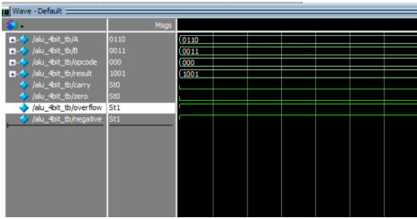

*Figure 3.1: Simulation Waveform for Addition Operation.*

### FPGA Implementation

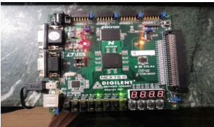

*Figure 3.2: FPGA implementation of ALU operating in Addition mode.*

---

## 3.2.2 Subtraction Operation

The Subtraction operation is selected when the opcode is `001`. The ALU subtracts operand B from operand A.

**Inputs:**
- A = `0110`
- B = `0011`
- Opcode = `001`

**Output:**
- Result = `0011`

### Simulation Waveform

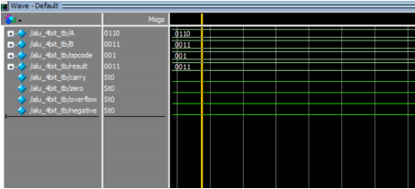

*Figure 3.3: Simulation Waveform for Subtraction Operation.*

### FPGA Implementation

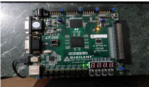

*Figure 3.4: FPGA implementation of ALU operating in Subtraction mode.*

---

## 3.2.3 AND Operation

The AND operation is selected when the opcode is `010`. The ALU performs a bitwise AND operation between operands A and B.

**Inputs:**
- A = `0110`
- B = `0011`
- Opcode = `010`

**Output:**
- Result = `0010`

### Simulation Waveform

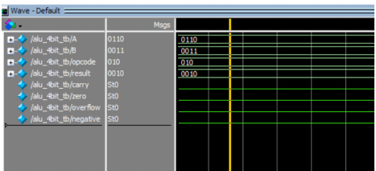

*Figure 3.5: Simulation Waveform for AND Operation.*

### FPGA Implementation

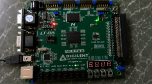

*Figure 3.6: FPGA implementation of ALU operating in AND mode.*

---

## 3.2.4 OR Operation

The OR operation is selected when the opcode is `011`. The ALU performs a bitwise OR operation between operands A and B.

**Inputs:**
- A = `0110`
- B = `0011`
- Opcode = `011`

**Output:**
- Result = `0111`

### Simulation Waveform

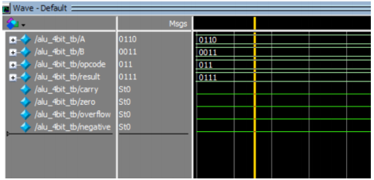

*Figure 3.7: Simulation Waveform for OR Operation.*

### FPGA Implementation

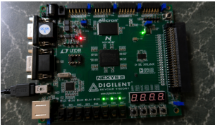

*Figure 3.8: FPGA implementation of ALU operating in OR mode.*

---

## 3.2.5 XOR Operation

The XOR operation is selected when the opcode is `100`. The ALU performs a bitwise Exclusive-OR operation between operands A and B.

**Inputs:**
- A = `0110`
- B = `0011`
- Opcode = `100`

**Output:**
- Result = `0101`

### Simulation Waveform

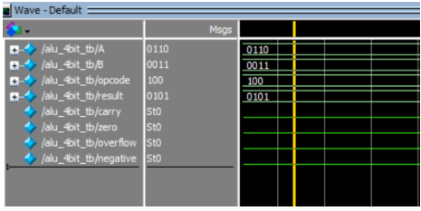

*Figure 3.9: Simulation Waveform for XOR Operation.*

### FPGA Implementation

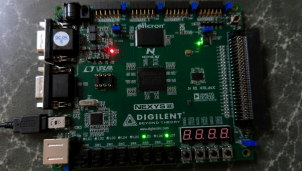

*Figure 3.10: FPGA implementation of ALU operating in XOR mode.*

---

## 3.2.6 NOT Operation

The NOT operation is selected when the opcode is `101`. In this operation, all bits of operand A are inverted while operand B is ignored.

**Inputs:**
- A = `0110`
- B = `0011`
- Opcode = `101`

**Output:**
- Result = `1001`

### Simulation Waveform

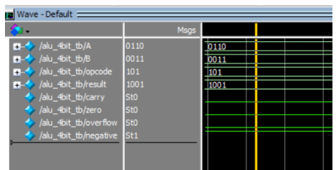

*Figure 3.11: Simulation Waveform for NOT Operation.*

### FPGA Implementation

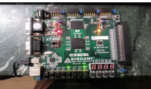

*Figure 3.12: FPGA implementation of ALU operating in NOT mode.*

---

## 3.2.7 Shift Left Operation

The Shift Left operation is selected when the opcode is `110`. The ALU shifts all bits of operand A one position toward the left.

**Inputs:**
- A = `0110`
- B = `0011`
- Opcode = `110`

**Output:**
- Result = `1100`

### Simulation Waveform

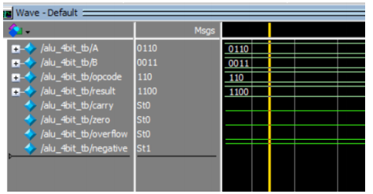

*Figure 3.13: Simulation Waveform for Shift Left Operation.*

### FPGA Implementation

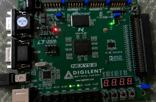

*Figure 3.14: FPGA implementation of ALU operating in Shift Left mode.*

---

## 3.2.8 Shift Right Operation

The Shift Right operation is selected when the opcode is `111`. The ALU shifts all bits of operand A one position toward the right.

**Inputs:**
- A = `0110`
- B = `0011`
- Opcode = `111`

**Output:**
- Result = `0011`

### Simulation Waveform

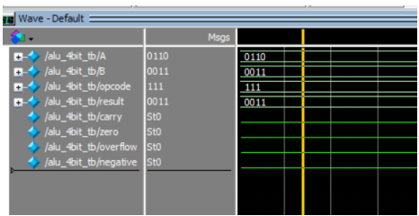

*Figure 3.15: Simulation Waveform for Shift Right Operation.*

### FPGA Implementation

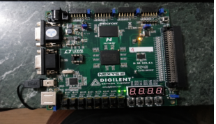

*Figure 3.16: FPGA implementation of ALU operating in Shift Right mode.*

---

## 3.3 Overall ALU Simulation Waveform

The complete simulation waveform demonstrates all eight supported ALU operations using fixed input operands A = `0110` and B = `0011`.

The opcode is varied sequentially from `000` to `111`, allowing each ALU operation to be observed.

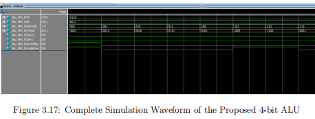

*Overall simulation waveform of the proposed 4-bit ALU.*

---

## 3.4 Summary of Simulation Results

| Opcode | Operation | Result |
|:---:|---|:---:|
| 000 | Addition | 1001 |
| 001 | Subtraction | 0011 |
| 010 | AND | 0010 |
| 011 | OR | 0111 |
| 100 | XOR | 0101 |
| 101 | NOT | 1001 |
| 110 | Shift Left | 1100 |
| 111 | Shift Right | 0011 |

## Conclusion

The simulation and FPGA implementation results documented in this project demonstrate the operation of the proposed 4-bit Arithmetic Logic Unit.

All eight operations are presented with their corresponding input values, output results, simulation waveforms and FPGA hardware implementation photographs.

The project demonstrates RTL design, functional simulation and FPGA-based implementation of a 4-bit ALU.
